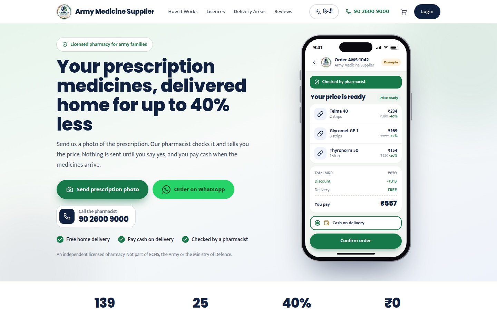
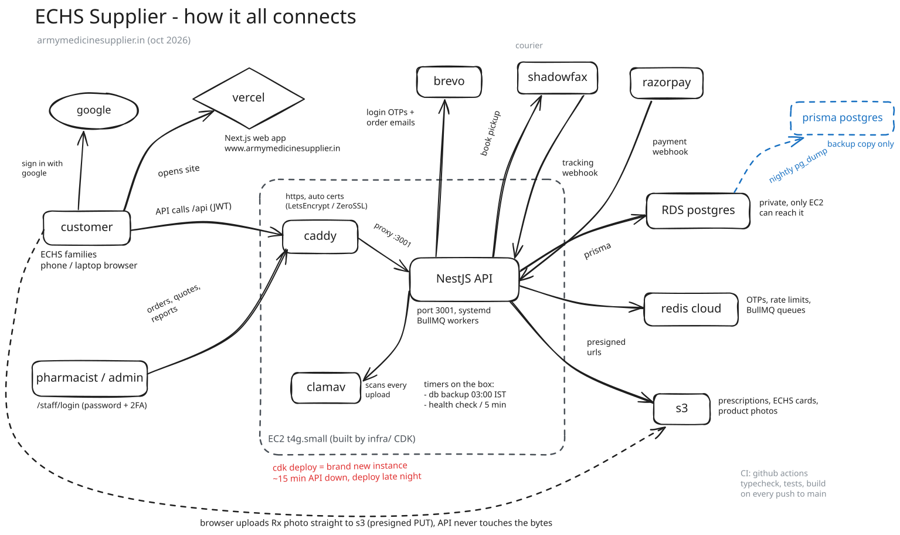
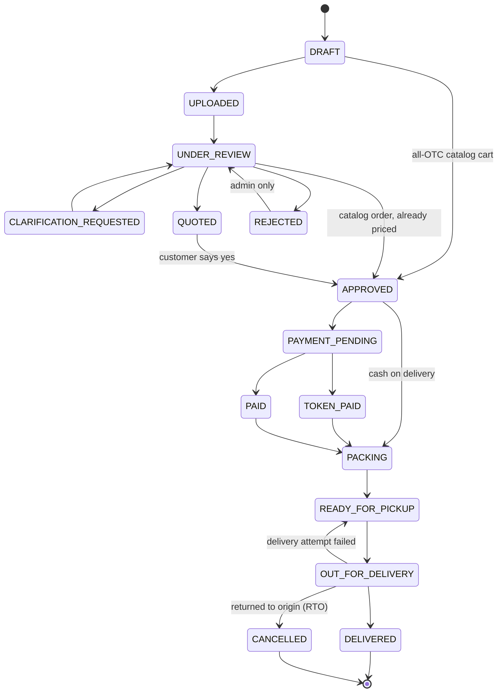
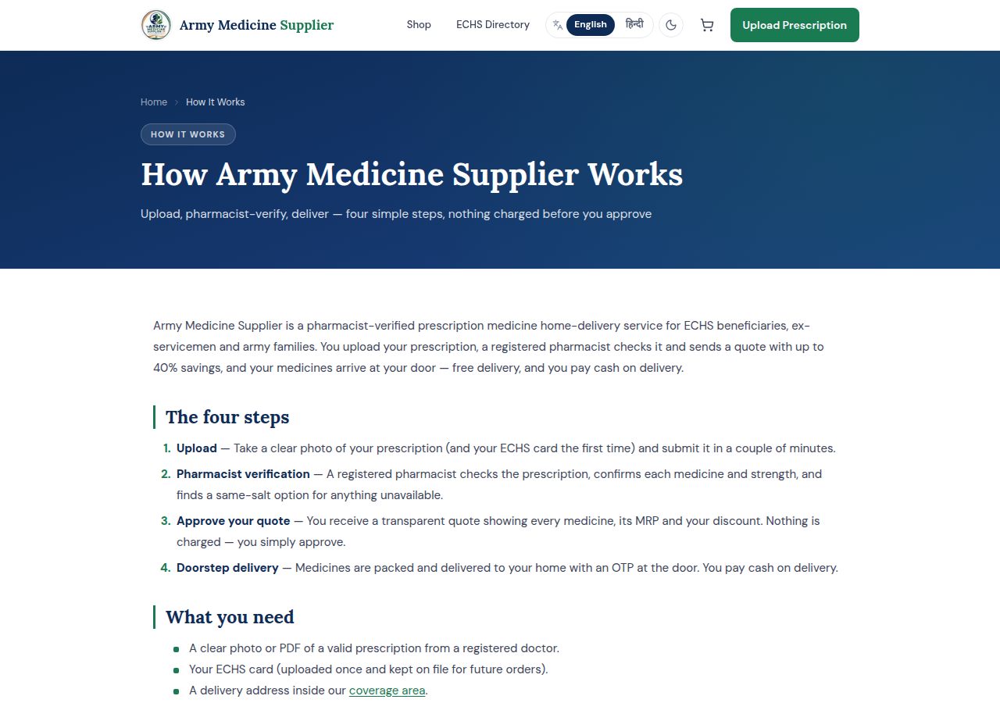

# Army Medicine Supplier

Production e-pharmacy and home-delivery platform for ECHS beneficiaries, ex-servicemen
and army families. A customer photographs a prescription, a registered pharmacist verifies
it and prices it, the customer says yes, and the medicines arrive at the door — usually
paid in cash on delivery.

**Live:** <https://www.armymedicinesupplier.in> · built and operated solo — product,
architecture, both apps, AWS infrastructure, on-call.

> This repository documents the system: architecture, infrastructure, data model, the order
> lifecycle and the engineering decisions behind them. The order state machine and its tests
> are included as real source, copied unmodified from the production API. The full source
> stays private — it is a live platform holding prescriptions, addresses and payments for
> real customers.



---

## At a glance

| | |
|---|---|
| **Monorepo** | npm workspaces — `apps/api` (NestJS), `apps/web` (Next.js), `infra` (AWS CDK) |
| **API** | NestJS 10 · 27 modules · 25 controllers · **183 REST endpoints** · Socket.IO gateway · ~22k lines of TypeScript |
| **Web** | Next.js 15 App Router · **94 pages** · 169 components · ~42k lines · English + हिंदी |
| **Data** | PostgreSQL 17 on AWS RDS · Prisma 5 · **37 models, 25 enums, 21 migrations** |
| **Tests** | 22 Jest suites · 145 tests — run on every push in GitHub Actions |
| **Infra** | AWS CDK (TypeScript): VPC, EC2 (Graviton), RDS, S3, IAM, CloudWatch — one `cdk deploy` |

---

## What it does

| | |
|---|---|
| **Prescription intake** | Photo of prescription + ECHS card, downscaled in the browser, uploaded straight to S3 via a pre-signed URL, then validated and virus-scanned |
| **Pharmacist review** | Review queue: verify, ask the customer for clarification, reject, or build a quote |
| **Quoting** | Line-item quote against live inventory (strips, tablet counts, MRP vs. our price) — nothing is dispatched until the customer approves |
| **Catalog checkout** | OTC, wellness and device carts skip prescription review entirely |
| **Payments** | Razorpay online checkout, or cash on delivery with settlement reconciliation |
| **Delivery** | Shadowfax API integration (book, track, cancel, RTO), plus own-rider and manually-booked couriers |
| **Real-time chat** | WhatsApp-style customer ↔ pharmacist chat over Socket.IO (typing, read receipts, unread counts) |
| **Notifications** | Transactional email and WhatsApp (Meta Cloud API) on every order state change, via a BullMQ queue |
| **Staff CRM** | Customer timeline (orders, calls, pages viewed), call-log queue, drop-off funnel, email campaigns with open tracking |
| **Storefront** | Bilingual, dark mode, ~40 SEO landing routes, sitemap, JSON-LD, OpenGraph images |

---

## Architecture



Drawn in Excalidraw. Source: [`assets/architecture.excalidraw`](assets/architecture.excalidraw)
(open it at [excalidraw.com](https://excalidraw.com) to edit).

**Why this shape**

- **Web on Vercel, API on EC2.** The storefront is mostly static, SEO-critical pages, which
  belong on a CDN edge (served from Mumbai). The API holds WebSocket connections, runs
  background workers and talks to ClamAV, so it wants a long-lived process, not functions.
- **One host, not Kubernetes.** A single Graviton instance runs the API, Caddy and ClamAV as
  systemd services. That is the right size for the traffic, and it costs a few dollars a month.
  Hardware failure is handled by a CloudWatch alarm that auto-recovers the instance onto
  healthy hardware with the same IP; process crashes by `Restart=always`.
- **Database in a private subnet.** RDS has no public address; only the API's security group
  can reach port 5432, and credentials live in a generated Secrets Manager secret. Deletion
  protection is on and the removal policy is `SNAPSHOT` — no stack change can drop patient data.
- **Two backup providers.** RDS keeps automated backups, and a systemd timer `pg_dump`s the
  database every night and restores it into Prisma Postgres, so a second provider always
  holds a usable copy.

### Inside the API

```
apps/api/src
├── auth/            Google sign-in, email OTP, staff password + 2FA (email or TOTP),
│                    JWT guard, RolesGuard, refresh-token rotation
├── orders/          order service + the state machine (src/order-state-machine.ts here)
├── pharmacist/      review queue, quotes, customer CRM, call logs, filters
├── delivery/        shipment booking, tracking sync, webhooks, RTO, manual AWBs
├── modules/         catalog · cart · inventory · payments · quotes · chat · reviews
│                    notifications · campaigns · files · users · addresses
│                    dependents · admin · settings
├── infra/           provider adapters, each behind an interface with a mock:
│   ├── storage/         S3 | database | local disk
│   ├── scanner/         ClamAV
│   ├── notify/          Brevo / SMTP email · Meta WhatsApp · MSG91 SMS
│   ├── delivery-partner/ Shadowfax
│   └── redis/
└── common/          global rate-limit guard, exception filters, error codes,
                     Swagger decorators, maintenance sweeps, utilities
```

Every external dependency — storage, virus scanner, email/WhatsApp/SMS, courier, payment
gateway — is injected through a provider interface chosen by an environment variable. Local
development and the test suite run against mocks; production config is validated at boot
(for example, production refuses to start unless file storage is S3).

---

## Roles

Five roles, enforced by `JwtAuthGuard` + `RolesGuard` on every controller:

`CUSTOMER` · `PHARMACIST` · `ADMIN` · `SUPER_ADMIN` · `DELIVERY`

Customers sign in with Google or a one-time code by email, then complete a profile (name and
an Indian mobile number). Staff sign in with a password plus a second factor (email code or
an authenticator app). Each role gets its own shell in the web app.

---

## The order lifecycle

Fifteen states, and the only legal moves are the ones in the table. Anything else throws
`InvalidStateTransitionException`. The machine is pure and I/O-free, so it is fully unit
tested — see [`src/order-state-machine.ts`](src/order-state-machine.ts) and its
[spec](src/order-state-machine.spec.ts).



(For readability the diagram leaves out cancellation, which is possible from every state
before delivery, and two back-edges: `QUOTED → CLARIFICATION_REQUESTED` and
`PAYMENT_PENDING → APPROVED`. The table in the source is the full truth.)

The shortcuts are the interesting part:

- **`DRAFT → APPROVED`** — an all-OTC/wellness/device cart has no prescription to verify,
  so it skips upload and review.
- **`UNDER_REVIEW → APPROVED`** — a catalog order containing a prescription item is already
  priced, so the pharmacist verifies it without building a quote.
- **`APPROVED → PACKING`** — cash on delivery skips the payment gate. The service layer
  restricts this edge to COD orders; the state machine alone would allow it for any order.
- **`OUT_FOR_DELIVERY → CANCELLED`** — the courier brought the parcel back (RTO). Stock
  and payment records are reconciled when it happens.

Every transition writes an `OrderStatusHistory` row with the actor; customer-facing changes
send a notification through the queue.

---

## Engineering notes

### Security

- **Auth tokens.** Short-lived (15 min) access JWTs, plus a refresh token in an `httpOnly`,
  `Secure` cookie scoped to `/api/auth` only. Refresh tokens are stored hashed (SHA-256),
  **rotated on every use**, and grouped into families: presenting an already-used token is
  treated as theft and revokes the whole family.
- **Instant revocation.** Logout, password reset and refresh-token reuse write revoked-session
  or per-user token-epoch keys to Redis, which the JWT guard checks — a revoked access token
  stops working immediately, not 15 minutes later.
- **Staff 2FA.** Pharmacists and admins need a second factor: an emailed code or TOTP.
- **Rate limiting.** A global Redis sliding-window guard covers every route, with tighter
  budgets on login and OTP. It fails open if Redis is down, so an outage can't lock everyone out.
- **Uploads.** The browser uploads directly to a private S3 bucket through a pre-signed URL.
  The API then re-checks the size, compares magic bytes against the declared MIME type,
  re-encodes images with `sharp` (which also strips EXIF/GPS) and scans the file with ClamAV.
  Infected or mismatched files are deleted and the order is blocked.
- **Webhooks.** Razorpay and courier callbacks are authenticated by HMAC-SHA256 over the raw
  request body, compared with `timingSafeEqual`, and deduplicated before they touch an order.
- **Input.** A global `ValidationPipe` with `whitelist` + `forbidNonWhitelisted` rejects
  unknown fields (mass-assignment defence). `helmet` headers, strict CORS allowlist.
- **Host hardening.** IMDSv2 only, encrypted volumes, only 80/443 open, API port never exposed,
  the instance reaches S3 through its IAM role — no long-lived AWS keys on the box.

### Payments and money

- Razorpay Standard Checkout: the server creates the order, the browser pays, the server
  verifies the signature. A separate **webhook** reconciles `payment.captured` independently,
  so a customer who closes the tab after paying still gets their order.
- **Idempotent reconciliation.** The browser's `verify` call and the webhook can arrive in
  either order, or more than once. A payment already `CAPTURED` is a no-op, and the state
  machine rejects a second transition, so an order is never billed or advanced twice. A
  webhook arriving for an order the customer has since switched to COD is caught too.
- All amounts are integers in **paise**; no floating-point money anywhere.
- **COD reconciliation.** `PaymentMode` records what the customer chose; `PaymentMethod`
  records how the money actually arrived — courier-collected cash (remitted on the courier's
  settlement cycle), our own rider's cash, UPI at the door, bank transfer. Settlement and
  profit reporting are built on that distinction.

### Delivery

- `ShipmentMethod` is `SHADOWFAX` (booked, tracked and cancelled through the API), `LOCAL`
  (own rider) or `MANUAL` (booked on another courier's dashboard, AWB entered by staff). If the
  API booking fails, staff can fall back to a manual booking without losing tracking.
- Tracking comes from courier webhooks, backed by an hourly sync of active shipments in case a
  webhook is lost. Every event is stored in `DeliveryTrackingEvent`; raw payloads in
  `DeliveryWebhookLog`.

### Reliability and operations

- **Background work off the request path.** Notifications, reminders and sweeps run on BullMQ
  queues, so a slow email or WhatsApp API never holds a customer request open. Redis is set to
  `noeviction` so queued jobs can't be evicted under memory pressure.
- **Errors.** Sentry on both apps, plus an `ErrorLog` table written by the global exception
  filter, which feeds an error dashboard in the admin panel. Every response carries an
  `x-request-id` trace id.
- **Audit trail.** Privileged actions write `AuditLog` rows with actor attribution — every
  prescription and money decision can be explained after the fact.
- **Health.** A systemd timer checks the API (locally and over public HTTPS), Caddy and the
  scanner every 5 minutes.
- **Deploys.** `cdk deploy` launches a fresh instance from user-data (build, migrate, start) —
  immutable-infrastructure style, so a host never drifts. The elastic IP is `RETAIN`ed because
  DNS records and the email provider's IP allowlist depend on it. TLS uses Let's Encrypt with a
  ZeroSSL fallback, because frequent instance replacement can hit one CA's rate limits.
- **Learning from an outage.** Hosted free-tier Postgres twice cut the API off at a usage
  quota. The fix was two-part: background work was cut to an hourly shipment sync and daily
  sweeps, and the database moved to RDS in the same region as the API, with the old provider
  kept as the nightly backup target.

### Frontend

- **Next.js 15 App Router**, React 18, Tailwind, TanStack Query for server state and Zustand
  for auth and cart. Standalone output.
- **SEO and GEO.** Around 40 static landing routes (`/echs-medicine-delivery`,
  `/military-hospitals`, `/same-salt-medicines`, coverage areas, conditions, guides) with a
  generated sitemap, `robots`, OpenGraph images, JSON-LD structured data and IndexNow
  submission. Customers search in plain language and in Hindi; the routes match how they search.
- **Bilingual UI** with a hand-written English/Hindi dictionary, not machine translation.
- **Low-bandwidth friendly.** Prescription photos are downscaled in the browser before upload;
  the browserslist targets older Android Chrome and iOS Safari used by the customer base.

### API documentation

Swagger/OpenAPI is generated from the controllers and DTOs, with shared error-response
schemas and documented error codes for every endpoint.

---

## Data model

37 Prisma models. The main groups:

| Area | Models |
|---|---|
| Identity | `User`, `UserProfile`, `Dependent`, `Session`, `Otp`, `Address` |
| Orders | `Order`, `OrderItem`, `OrderStatusHistory`, `OrderFile`, `FileBlob` |
| Pricing | `Quote`, `QuoteItem`, `Product`, `Category`, `Inventory`, `InventoryTransaction` |
| Money | `Payment`, `PaymentLog`, `Refund`, `IdempotencyKey` |
| Delivery | `Delivery`, `DeliveryTrackingEvent`, `DeliveryWebhookLog` |
| Commerce | `Cart`, `CartItem`, `Review`, `ReviewReply`, `ReviewHelpful` |
| Engagement | `ChatRoom`, `ChatMessage`, `Notification`, `CustomerCallLog`, `CustomerPageView` |
| Platform | `AuditLog`, `ErrorLog`, `AppSetting` |

Stock that moves because of an order — a sale, or a parcel returned to origin — is written as
an `InventoryTransaction` row (`SALE`, `RETURN`, `PURCHASE`, `ADJUSTMENT`, `EXPIRY_WRITE_OFF`)
in the same database transaction as the stock change.

---

## Testing and CI

GitHub Actions runs on every push and pull request:

1. `npm ci` and `prisma generate`
2. TypeScript typecheck — API and web
3. Jest unit tests — API (22 suites, 145 tests)
4. Production builds — API and web

The suites cover the order state machine, payment verification and webhook reconciliation,
the rate-limit guard, onboarding, Shadowfax booking and RTO handling, WhatsApp delivery,
email templates, chat conversations, the drop-off funnel and input utilities (Indian mobile
numbers, email addresses, image optimisation, webhook signatures).

---

## Stack

| Layer | Choice |
|---|---|
| Web | Next.js 15 (App Router), React 18, TypeScript, Tailwind, TanStack Query, Zustand |
| API | NestJS 10, TypeScript, class-validator, Swagger |
| Data | PostgreSQL 17 (AWS RDS), Prisma 5 |
| Cache / queues | Redis Cloud, BullMQ, ioredis |
| Realtime | Socket.IO |
| Auth | JWT, rotating refresh tokens, Google OAuth, email OTP, TOTP (otplib), bcrypt |
| Payments | Razorpay |
| Delivery | Shadowfax API |
| Files | AWS S3 (pre-signed URLs), sharp, ClamAV |
| Messaging | Meta WhatsApp Cloud API, Brevo / SMTP email |
| Monitoring | Sentry, CloudWatch |
| Infra | AWS CDK, EC2 Graviton, Caddy, systemd, Vercel, Docker Compose (local), GitHub Actions |

---

## Screenshots

| How it works | Shop |
|---|---|
|  |  |

---

## Status

Live and serving orders.

Independent licensed pharmacy. Not affiliated with ECHS, the Indian Army or the Ministry of Defence.

---

Built by [Shaurya Shakya](https://github.com/shaurya-8055) · [armymedicinesupplier.in](https://www.armymedicinesupplier.in)
